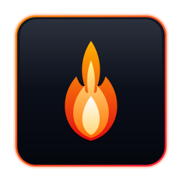
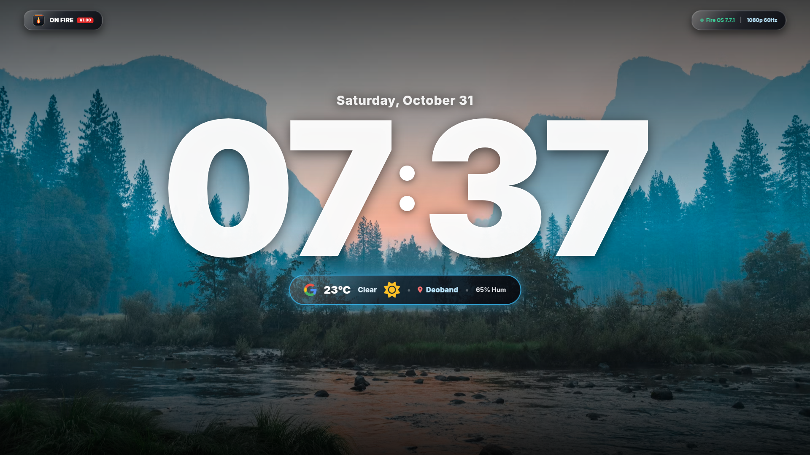
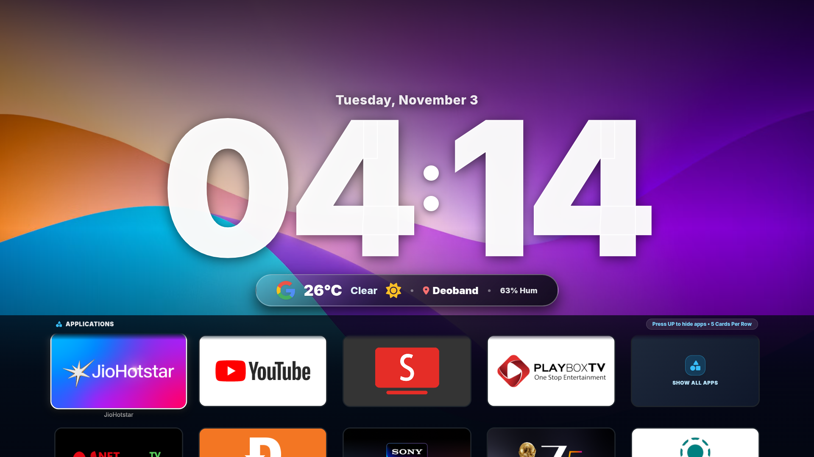
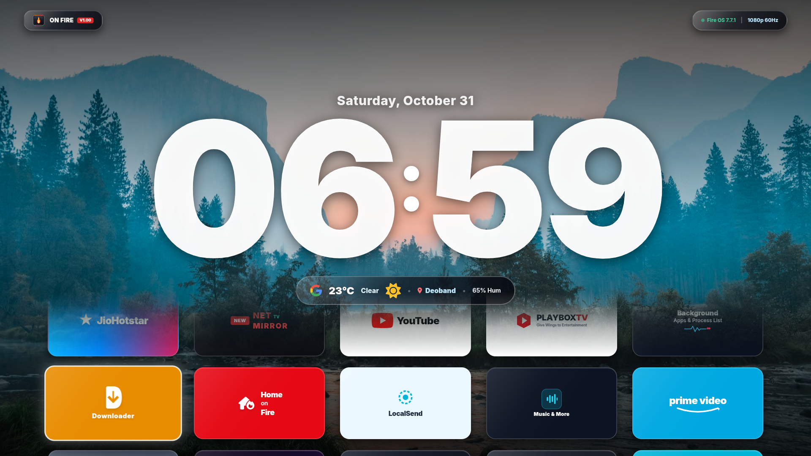
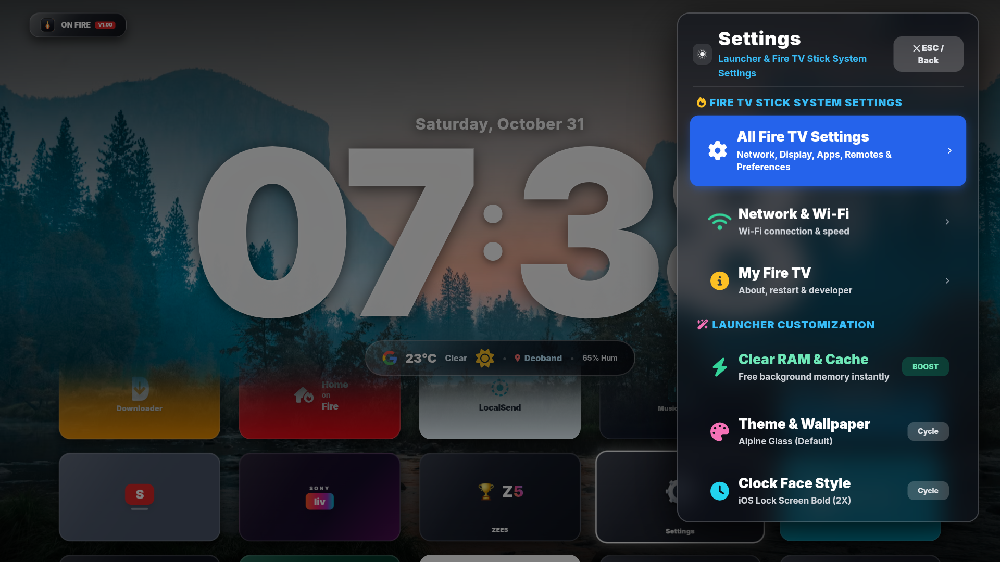
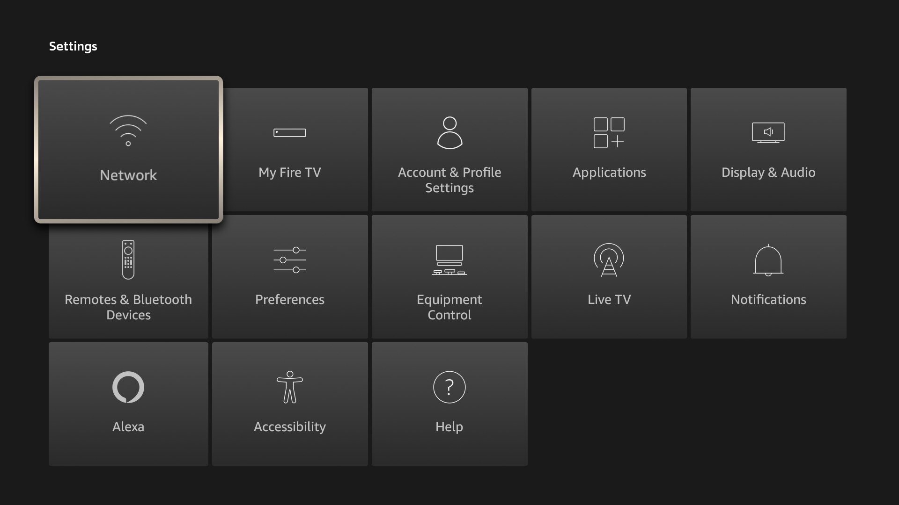

<p align="center">
  <br>
  
  <br><br>
</p>

<h1 align="center">🔥 On Fire — Liquid Glass TV Launcher</h1>

<p align="center">
  <strong>The ultra-lightweight, zero-bloat Leanback launcher engineered for Amazon Fire TV, Google TV, and Android TV.</strong>
</p>

<p align="center">
  <em>Say goodbye to sponsored video trailers, cluttered recommendation rows, and sluggish navigation.</em>
</p>

<p align="center">
  <a href="https://github.com/sakhanamit/OnFire-Leanback-Launcher/releases/latest">
    
  </a>
  <a href="https://github.com/sakhanamit/OnFire-Leanback-Launcher/stargazers">
    
  </a>
  <a href="https://github.com/sakhanamit/OnFire-Leanback-Launcher">
    
  </a>
  <a href="LICENSE">
    
  </a>
</p>

<br>

<p align="center">
  <a href="https://github.com/sakhanamit/OnFire-Leanback-Launcher/raw/main/releases/v1.1/OnFire-v1.1-FireTV-Stick-Lite-4K-FireOS7.apk">
    
  </a>
  &nbsp;&nbsp;
  <a href="https://github.com/sakhanamit/OnFire-Leanback-Launcher/raw/main/releases/v1.1/OnFire-v1.1-Universal-GoogleTV-AndroidTV.apk">
    
  </a>
  &nbsp;&nbsp;
  <a href="https://github.com/sakhanamit/OnFire-Leanback-Launcher/raw/main/releases/v1.1/OnFire-v1.1-Legacy-AndroidTV-FireOS5.apk">
    
  </a>
</p>

<br>

---

## 🌟 What's New in v1.1.0 (Changelog)

- 🚀 **Zero-Lag & Zero-Flicker Hardware Engine**:
  - Removed all artificial `translateZ(0)` and `will-change: transform` layer promotions that caused texture thrashing on entry-level Mali-G52 GPUs (Fire TV Stick Lite & 4K).
  - Eliminated expensive CSS blur filters (`backdrop-filter`) across the launcher, ensuring locked **60 FPS** frame rates.
  - Replaced JavaScript per-card opacity calculation loops (`requestAnimationFrame`) with pure hardware compositor scrolling.
- 🌤️ **Enlarged High-Visibility Weather Widget**:
  - Weather widget increased in size with a **44×44px** Google Weather icon, **4xl bold temperature**, and **2xl condition & city** typography for effortless 10-foot viewing.
- 📌 **Pinned Stationary Applications Header**:
  - The "Applications" and "Press UP to hide apps" navigation header is now pinned at the top and never scrolls up.
- 🛡️ **Protected Weather & Clock Viewport**:
  - Application cards are strictly clipped within the lower section (`top: 745px; overflow: hidden`) with a subtle hardware fade mask. **No cards or headers ever scroll above or block the weather widget and clock**.
- 🔍 **Refined Spotlight Weather Search**:
  - Cleaned up footer branding in the weather location modal to display only essential remote D-Pad navigation controls.
- 📱 **Row 1 Recently Opened Apps & All Apps Grid**:
  - The first row dynamically prioritizes your most recently launched apps and ends with **"Show All Apps"** to view all installed apps excluding system background packages.
- 🎬 **Official Prime Video 16:9 Banner**:
  - Dedicated custom Prime Video banner tile with official branding and gradient backdrop.
- ⚙️ **Enhanced Settings Menu**:
  - Upgraded to a clean, large gear icon and high-contrast list-style settings menu.

---

## ⚡ The Difference: Stock OS vs. On Fire

| Feature | Stock Fire OS / Google TV | 🔥 On Fire Launcher |
|:---|:---:|:---:|
| **Sponsored Ads & Video Autoplay** | ❌ Full-screen intrusive ads | ✅ **100% Ad-Free, Forever** |
| **RAM Footprint** | ❌ 450 MB – 850 MB background bloat | ✅ **~12 MB RAM** (Leaves 95%+ RAM for streaming) |
| **Binary Package Size** | ❌ 100+ MB system payload | ✅ **116 KB** (Instant installation & launch) |
| **Frame Rate & Responsiveness** | ❌ 30-45 FPS micro-stutters on Stick Lite | ✅ **Locked 60 FPS** with zero-flicker compositing |
| **Settings Access** | ❌ Buried 4 levels deep in submenus | ✅ **1-Click Side Drawer** + Root 13-Tile Settings Grid |
| **Audio Feedback** | ❌ Inconsistent remote clicks | ✅ **Native AudioManager clicks** on all moves |

---

## 📸 Visual Showcase

<p align="center">
  <strong>Minimalist Centered Clock & Live Google Weather</strong><br>
  <em>Clean aesthetic keeping your 4K wallpapers front-and-center</em><br>
  
</p>

<br>

<table align="center" width="100%">
  <tr>
    <td width="50%" align="center">
      <strong>🎯 5-Card Ergonomic App Grid</strong><br>
      <em>Large 310×170px cards designed for 10-foot viewing</em><br><br>
      
    </td>
    <td width="50%" align="center">
      <strong>🎬 Upward Fade Transition</strong><br>
      <em>Apps fade seamlessly behind header without blur stutter</em><br><br>
      
    </td>
  </tr>
  <tr>
    <td width="50%" align="center">
      <br><strong>🌫️ 50% Translucent Side Settings Drawer</strong><br>
      <em>Apple TV-style compact panel with 2X typography</em><br><br>
      
    </td>
    <td width="50%" align="center">
      <br><strong>⚙️ Direct Root Fire TV System Settings</strong><br>
      <em>Instant 1-click access to all 13 native system categories</em><br><br>
      
    </td>
  </tr>
</table>

---

## 🚀 Key Innovations

### 🎯 5-Card Ergonomic Row Grid
Unlike crowded multi-column launchers, On Fire arranges applications in **exactly 5 large cards per row** (`310px × 170px` with 36px column gaps). Each card features high-contrast vector typography, glowing ambient neon focus rings, and direct package launching.

### 🌫️ Apple TV-Style 50% Translucent Settings Drawer
Pressing Settings summons an elegant **580px wide side drawer** rendered with **50% background translucency** (`rgba(12, 16, 26, 0.50)` + hardware blur). Submenu entries are doubled in size (`26px` bold headers, `17px` descriptions, and `40px` icons) for effortless reading from across the living room.

### ⚙️ One-Click Root Fire TV System Settings
No more navigating labyrinthine menus to clear app data. Selecting **"All Fire TV Settings"** immediately launches Fire TV’s full root settings matrix (`com.amazon.tv.launcher/.ui.MainSettingsActivity`), giving you direct access to *Network, Display & Audio, Applications, Remotes & Bluetooth, My Fire TV, Equipment Control, and Accessibility*.

### ⚡ Zero-Flicker Hardware Compositor
Specially engineered for low-memory, entry-level streaming chips (like the MediaTek quad-core on Fire TV Stick Lite / 1 GB RAM):
- **DOM Mutation Throttling**: The clock only recalculates when the minute ticks, eliminating 60 redundant full-page layout reflows per minute.
- **GPU Layer Anchoring**: Enforced `transform: translateZ(0)` and `backface-visibility: hidden` prevents Chromium texture buffer drops.
- **Sticky Immersive Lock**: Locks fullscreen immersive flags on focus change to prevent microsecond black-screen relayout flashes.

### 🔊 Authentic Remote D-Pad Sounds
Integrated directly with Android’s low-latency `AudioManager` sound pool. Every directional press (<kbd>▲</kbd>, <kbd>▼</kbd>, <kbd>◀</kbd>, <kbd>▶</kbd>) and selection (<kbd>OK</kbd>) plays the crisp, familiar navigation click.

### 🧹 One-Click Memory Cleaner
Free up RAM instantly before opening demanding streaming apps or cloud gaming services with the built-in background process termination tool.

---

## 🎮 Remote Control Shortcuts

<p align="center">
  <kbd>&nbsp;▼ DOWN&nbsp;</kbd> &nbsp;Reveals the app drawer and scrolls through rows<br><br>
  <kbd>&nbsp;▲ UP&nbsp;</kbd> &nbsp;Returns focus to top or tucks the app drawer away<br><br>
  <kbd>&nbsp;◀ LEFT&nbsp;</kbd> / <kbd>&nbsp;▶ RIGHT&nbsp;</kbd> &nbsp;Steps smoothly across cards in a row<br><br>
  <kbd>&nbsp;SELECT / OK&nbsp;</kbd> &nbsp;Launches application or triggers settings toggle<br><br>
  <kbd>&nbsp;BACK / RETURN&nbsp;</kbd> &nbsp;Closes settings drawer or returns cleanly to home clock
</p>

---

## 📥 Quick Installation Guide

<details open>
<summary><strong>Method 1: Sideload via Downloader App (Recommended for TV)</strong></summary>

<br>

1. Install the **Downloader** app from the Amazon Appstore or Google Play Store.
2. Open Downloader and enter the direct download URL for your device:
   - **Fire TV Stick (Lite, 4K, Max)**: `https://github.com/sakhanamit/OnFire-Leanback-Launcher/raw/main/releases/v1.1/OnFire-v1.1-FireTV-Stick-Lite-4K-FireOS7.apk`
   - **Google TV & Android TV 9–14+**: `https://github.com/sakhanamit/OnFire-Leanback-Launcher/raw/main/releases/v1.1/OnFire-v1.1-Universal-GoogleTV-AndroidTV.apk`
   - **Legacy Fire OS 5 & Android TV 5–8**: `https://github.com/sakhanamit/OnFire-Leanback-Launcher/raw/main/releases/v1.1/OnFire-v1.1-Legacy-AndroidTV-FireOS5.apk`
3. Click **Install**, then grant the install unknown apps permission.
</details>

<details>
<summary><strong>Method 2: Sideload via ADB (Fast for Developers)</strong></summary>

<br>

```bash
# 1. Connect to your TV over Wi-Fi
adb connect 192.168.0.XXX:5555

# 2. Install the signed APK
adb install -r OnFire-v1.1-FireTV-Stick-Lite-4K-FireOS7.apk

# 3. Launch On Fire immediately
adb shell am start -n com.onfire.launcher/.MainActivity
```
</details>

---

## 🛠️ Building from Source

```powershell
# Clone the repository
git clone https://github.com/sakhanamit/OnFire-Leanback-Launcher.git
cd OnFire-Leanback-Launcher

# Run the automated build script (Compiles, DEXs, ZipAligns, and Signs)
powershell -ExecutionPolicy Bypass -File compile_both.ps1
```

---

## 📁 Repository Map
OnFire-Leanback-Launcher/ ├── android_project/ # Complete Android Studio project source │ ├── app/ │ │ ├── src/main/assets/ # Liquid Glass TV frontend (HTML5 / Tailwind / JS) │ │ ├── src/main/java/ # Native Android Java bridges & intents │ │ └── src/main/res/ # Leanback TV banner & vector launcher icons │ └── build.gradle # Gradle project definition ├── releases/ # Pre-compiled, dual-signed production APKs ├── screenshots/ # High-contrast 1080p verified screenshots ├── compile_both.ps1 # Fast independent build pipeline script ├── logo.png # High-resolution centered flame icon ├── LICENSE # MIT License └── README.md # Showcase documentation

---

<p align="center">
  <strong>Crafted with passion for clean TV experiences.</strong><br>
  Released under the <a href="LICENSE">MIT License</a>.
</p>
